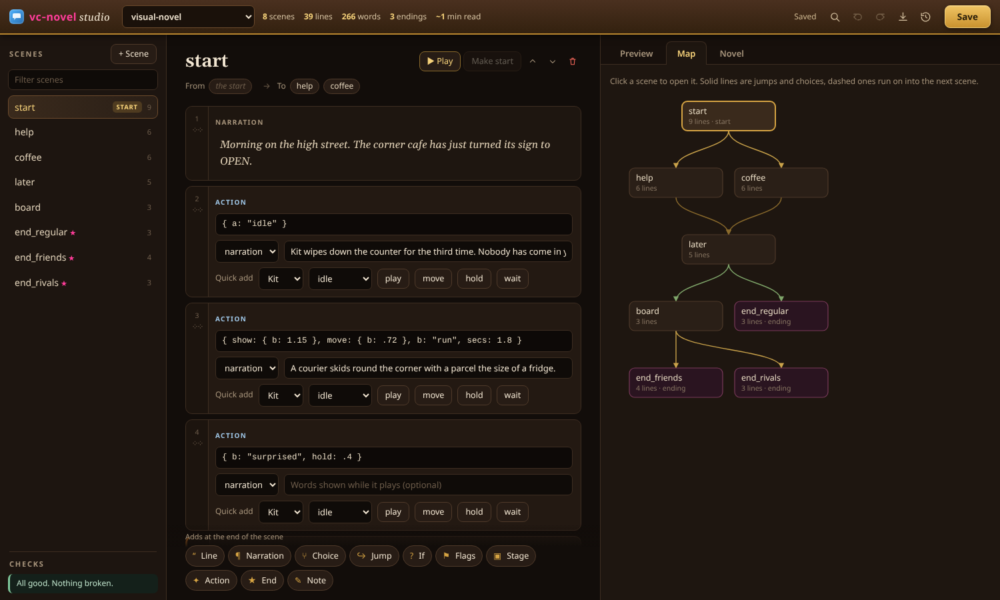

# Vibe City Mod Kit

**Make your own buildings, characters and stories for [Vibe City](#get-vibe-city)**, a cosy isometric city builder in the spirit of SimCity 2000.

This repo has everything a modder needs: ready-to-copy templates, the visual novel editor, the tools we use to check building art, and plain-language docs.

| | |
|---|---|
| 🏠 **[Building](templates/building)** | The smallest complete mod: a building, four pictures, and a window that can pay into the city's funds. |
| 🎮 **[Micro game](templates/micro-game)** | *Bean Catcher*, a small arcade game inside a building: rounds, a best score saved with the city, tips paid into its funds. |
| 📖 **[Visual novel](templates/visual-novel)** | A full little story with a cast, choices, flags, three endings and a Scenes menu. |
| 🎬 **[Animation framework](templates/animation)** | Characters acting out scenes from sprite strips: walking, high fives, sitting, racing. |
| 🖼️ **[Static scenes](templates/static-scenes)** | Four scenes with play buttons, made from still pictures. The easiest way to start. |
| ✍️ **[VC Novel Studio](studio)** | A desktop editor for visual novels: scenes as cards, live preview, scene map, checks, backups. |
| 🔧 **[Tools](tools)** | Check, slice and fix building sprite strips before they go in. |

## Quick start

1. Install Vibe City (desktop version: mods do not run in a browser tab).
2. Copy any folder from `templates/` into `Documents/Vibe City/mods/` (on Linux `~/Documents/Vibe City/mods`).
3. Start the game. Your building is in the build menu, in the drawer `mod.json` names (the templates use **Decor**).
4. Click it with the pan tool to open its window.

Then change `id` in its `mod.json` to something only yours, swap the art, and make it your own.

## Docs

| Guide | What it covers |
|---|---|
| [MODDING.md](docs/MODDING.md) | The mod format: `mod.json`, the four pictures, facing the street, window pages and the messages they can send. **Start here.** |
| [micro-games.md](docs/micro-games.md) | Little games inside buildings: the loop, screens, pausing, saving, paying the city. |
| [sprites.md](docs/sprites.md) | Drawing or generating building pictures that sit on the tile, and checking them. |
| [visual-novels.md](docs/visual-novels.md) | `story.js`, `actors.js`, choices, flags, endings, the Scenes menu. |
| [animation.md](docs/animation.md) | Sprite strips, moves, steps, touching moves, hooks. |
| [static-scenes.md](docs/static-scenes.md) | Still-picture scenes, moves and effects. |
| [packing.md](docs/packing.md) | Installing, packing to `.asar`, sharing. |

## VC Novel Studio



Prebuilt for Linux, Windows and macOS on the [Releases](../../releases) page. Or run it from source:

```bash
cd studio && npm install && npm start
```

## Repo layout

```
docs/               the guides
templates/          copy one into Documents/Vibe City/mods to start
  building/
  micro-game/
  visual-novel/
  animation/
  static-scenes/
studio/             VC Novel Studio (Node + Electron, no framework)
tools/              Python sprite tools (pip install -r tools/requirements.txt)
sprite-templates/   the plot template for building art
```

## Get Vibe City

Store links coming soon.

## More from me

- [All my projects on GitHub](https://github.com/fswolf)
- [sfav](https://github.com/fswolf/sfav): a TUI launcher for your favourite commands

## License

Code and templates: [MIT](LICENSE). The placeholder art in the templates is free to use in your mods. Fonts in `studio/fonts`: SIL Open Font License.

Contributions welcome: see [CONTRIBUTING.md](CONTRIBUTING.md).
